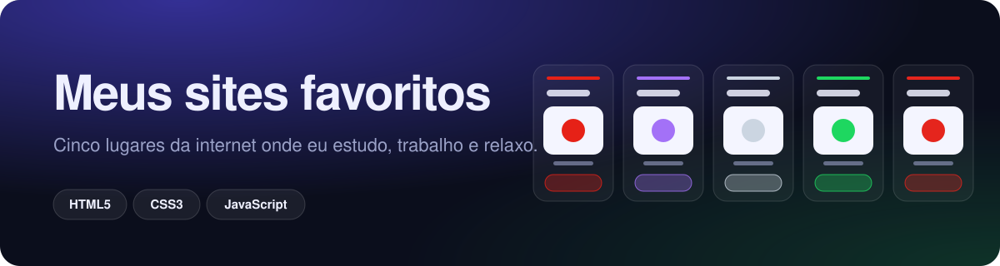
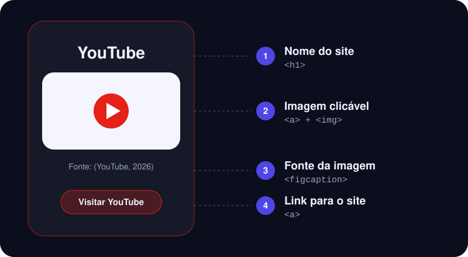

<div align="center">




</div>

# Meus Sites Favoritos

Página web desenvolvida como atividade da Etec (curso técnico): uma galeria com cinco sites favoritos, onde cada um aparece com **nome**, **imagem**, **fonte da imagem** e **link**. As imagens vêm direto de outros sites, sem precisar baixar nada.

## Regras da atividade

| Requisito | Como foi feito |
| --- | --- |
| Título da aba: `Meus sites favoritos` | Tag `<title>` |
| Título do corpo: `Meus sites favoritos: Nicholas Vieira` | Tag `<h1>` do cabeçalho |
| 5 imagens de sites | YouTube, GitHub, Wikipédia, Spotify e Centro Paula Souza |
| Nome do site acima da imagem | `<h1>` dentro de cada cartão |
| Link abaixo de cada imagem | Botão com a tag `<a>` |
| Opcional: link nas imagens | Cada imagem também é um link |
| Fonte da imagem | `<figcaption>` logo abaixo da imagem |

## Anatomia de um cartão

<div align="center">



</div>

## Destaques

- Tema escuro com **luz de fundo que muda para a cor de cada site** ao passar o mouse
- Cartões com **inclinação 3D** e reflexo que acompanham o mouse
- Layout responsivo com **Flexbox**: funciona em celular, tablet e computador
- Cores e fontes centralizadas em **variáveis CSS**
- Imagem de reserva (a inicial do site) caso uma logo não carregue
- Acessibilidade: navegação por teclado e respeito a quem prefere menos movimento
- Código **todo comentado**

## Arquivos do projeto

| Arquivo | Descrição |
| --- | --- |
| `nicholas_Ag12_DS_I.html` | Página completa: HTML, CSS e JavaScript em um só arquivo. |
| `LICENSE` | Licença MIT. |

```
meus_sites_favoritos/
├── src/
│   ├── nicholas_Ag12_DS_I.html
│   └── img/
│       ├── banner.svg
│       └── anatomia_do_cartao.svg
├── LICENSE
└── README.md
```

## Como executar

Pré-requisito: um navegador e conexão com a internet, para carregar as imagens e as fontes.

```
git clone https://github.com/Yunoratsu/meus_sites_favoritos.git
cd meus_sites_favoritos
```

Depois, é só abrir o arquivo `nicholas_Ag12_DS_I.html` com duplo clique.

## Estrutura do código

O arquivo está dividido em três partes:

- **HTML:** cabeçalho com o título e uma galeria de `<article>`. Cada cartão usa `<h1>` para o nome, `<figure>` com `<figcaption>` para a imagem e sua fonte, e `<a>` para o link.
- **CSS:** organizado em seções numeradas (variáveis, base, cabeçalho, cartões, imagem e fonte, botão, rodapé e acessibilidade). A cor de cada site fica na variável `--cor` do próprio cartão.
- **JavaScript:** só efeitos visuais, em funções pequenas:
  - `definirAmbiente(cor)` muda a luz de fundo da página.
  - `corDoCartao(cartao)` lê a cor da marca do cartão.
  - `inclinar(cartao, evento)` calcula a inclinação 3D e a posição do reflexo.
  - `endireitar(cartao)` devolve o cartão à posição reta.
  - `mostrarInicial(imagem)` troca uma imagem quebrada pela inicial do site.

## Conceitos aplicados

- Estrutura semântica do HTML5 (`header`, `main`, `article`, `figure`, `footer`)
- Tags `<title>`, `<h1>`, `` e `<a>`
- Layout com Flexbox e design responsivo
- Variáveis CSS, `color-mix()` e `@property`
- Transições, animações e transformações 3D
- Manipulação do DOM e eventos em JavaScript
- Acessibilidade (`alt`, foco visível, `prefers-reduced-motion`)

## Autor

Atividade desenvolvida por Nicholas Vieira.

[](https://github.com/Yunoratsu)

## Licença

Distribuído sob a licença MIT. Veja o arquivo [LICENSE](LICENSE).
